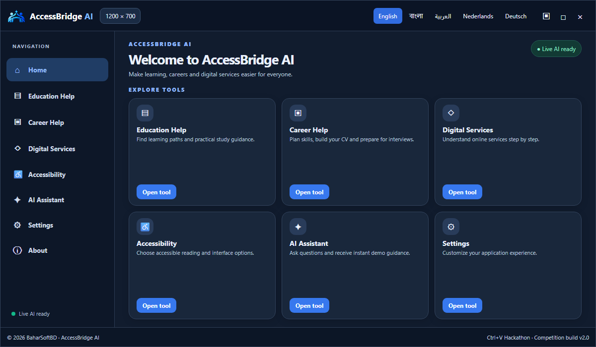

# AccessBridge AI

AccessBridge AI is a multilingual, accessibility-first assistant that helps people navigate education, career preparation, and essential online services. It was created by **MD Zakir Hossain** for the [Ctrl+V Hackathon](https://ctrl-v-hackathon-31831.devpost.com/).

> Pre-hackathon baseline: this repository records the project state prepared before the official event window. Any competition-period work must be committed honestly during the official hackathon dates.

## Problem

Many people face digital barriers caused by complex instructions, unfamiliar language, inaccessible interfaces, and limited confidence using online services. These barriers affect access to learning, careers, government services, and other essential resources.

## Solution

AccessBridge AI turns a user's topic, level, and personal goal into a practical step-by-step plan. It combines a live AI service with a safe rule-based fallback and provides multilingual and accessibility controls in a responsive desktop-style interface.

## Key features

- Personalized education, career, and digital-service guidance
- Live AI mode with safe local fallback
- English, Bengali, Arabic, Dutch, and German
- Right-to-left Arabic layout
- Saved plans and chat history in browser-local storage
- Copy, text download, print-friendly content, and read-aloud support
- Optional browser speech input
- Large-text, high-contrast, keyboard focus, skip-link, and reduced-motion support
- Privacy and verification notices
- Responsive 1200 × 700 desktop-window experience

## Live application

[https://accessbridge.baharsoftbd.com/](https://accessbridge.baharsoftbd.com/)

## Screenshot



## Architecture

```text
Browser UI (HTML/CSS/JavaScript)
        │
        ├── Local privacy-first storage (settings, plans, chat history)
        │
        └── POST /api-chat.php
                 │
                 └── Groq-compatible chat API (server-side key only)
```

If the live AI request is unavailable, the interface returns a safe local plan instead of losing the user's input.

## Run locally

The frontend is buildless and can be served by any static web server.

```bash
npx http-server . -p 8765 -c-1
```

Open `http://127.0.0.1:8765`.

For Live AI:

1. Copy `api-chat.example.php` to `api-chat.php` on a PHP host.
2. Set `GROQ_API_KEY` on the server. Never put the key in source code.
3. Optionally set `GROQ_MODEL`.

## Privacy and safety

- Plans and chat history stay in the current browser unless the user clears browser storage.
- The public source contains no API key, hosting password, or cPanel session information.
- Users are warned not to enter passwords, OTPs, or sensitive identity information.
- Important service information should be verified on the relevant official website.

See [PRIVACY.md](PRIVACY.md) and [SECURITY.md](SECURITY.md).

## Testing

The current smoke-test record is in [docs/TESTING.md](docs/TESTING.md). It covers responsive layout, personalized fallback guidance, saved plans, multilingual controls, accessibility settings, and server-failure fallback.

## Hackathon evidence

- The repository history is the source of truth for development dates.
- The current commit is explicitly a **pre-hackathon baseline**.
- Substantial event-period work must be committed during the official event window.
- Demo video and Devpost submission are intentionally not included yet.

See [HACKATHON_BUILD_PLAN.md](HACKATHON_BUILD_PLAN.md).

## Technology

- Semantic HTML5
- Modern CSS with responsive and accessibility media queries
- Vanilla JavaScript
- PHP server endpoint
- Groq-compatible chat completion API
- Browser Web Speech and Speech Synthesis APIs where supported

## License

Released under the [MIT License](LICENSE).

